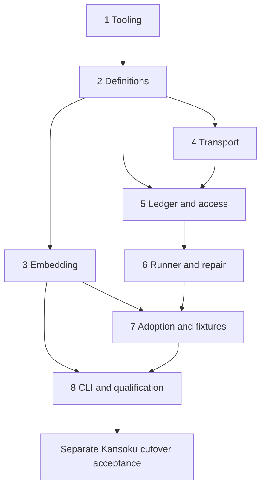

# Bootstrap the initial ClickHouse migration library

This MasterPlan is a living document. Keep the registry and coordination sections current; child plans own implementation milestones. Distill durable decisions into `docs/adr/` before completion.

## Vision & Scope

Deliver the first releasable implementation of `docs/initial-spec.md`: Haskell libraries export explicitly ordered migration components, applications embed and compose them, and administrative code executes each SQL step once per authorized attempt against one pinned ClickHouse server. Immutable history records intent and observed outcomes; interrupted or uncertain work blocks ordinary execution and requires explicit audited recovery. Users can inspect, verify, adopt legacy history and mount a reusable CLI without surrendering application configuration, logging or exit policy.

The four public packages are `clickhouse-migrate`, `clickhouse-migrate-embed`, `clickhouse-migrate-cli`, and `clickhouse-migrate-test-support`, in the root directories already declared by `mori.dhall`. Tooling starts with `mori://shinzui/seihou-modules/templates/nix-haskell-flake`; Haskell code follows `mori://shinzui/haskell-jitsurei/docs/core-standards` and its applicable prelude, record and multiline-string recipes. The core must not depend on PostgreSQL, pg-migrate, embedding, CLI or test support.

Scope includes reproducible tooling, pure definitions and SQL envelope, exact-byte checksums/embedding, direct HTTP transport, target identity, exclusive access, immutable ledger, runner/inspection/repair, generic adoption, consumer fixtures, CLI, operational documentation and release qualification. The actual first-consumer cutover is a separate change at `mori://shinzui/kansoku`, with explicit evidence required to close the initiative. It is not a request to run migrations on a live database during planning. Release preparation does not imply package publication or deployment.

Keep the spec's exclusions: no down migrations, automatic retries/rollback/repair, arbitrary Haskell actions, runtime discovery, database-neutral framework, distributed/Cloud/replicated execution, built-in distributed coordination, background migration scheduling, ledger-owning user SQL, or schema-equality claims. Exactly-once SQL and atomic SQL-plus-ledger commit are not guarantees. Pending work is compatible; unresolved work is blocking. Implementation is proceeding in the registry order; the registry and child acceptance evidence record the current state.

## Decomposition Strategy

The repository currently contains the specification, Mori/Mina metadata and planning skills. There are no implemented packages, build commands or CI. The pre-implementation review added one local ADR. Eight children separate independently demonstrable behaviors: a buildable workspace, pure definitions, compiled definitions, one-shot HTTP behavior, guarded durable history, safe execution/recovery, evidence-preserving adoption and an application-facing release surface. Test support grows alongside the transport and its consumers; a late test-only plan would discover protocol defects too late. Ledger and runner are separate because storage/projection and execution coordination have different failure contracts, while inspection and repair remain with the runner because they share its state machine.

No local ADR or profiled ADR bundle existed at creation. The update adds [Preserve uncertainty across runtime boundaries](../adr/0001-preserve-uncertainty-across-runtime-boundaries.md), recording request-outcome distinctions, all-request quiescence, early shared-type ownership and invariant-safe test/embedding boundaries. There is still no profiled ADR bundle. Mori discovery found two relevant decisions: `mori://shinzui/rei/okf/adrs/concepts/ADR-11` shows that imported history does not prove fresh replay; `mori://shinzui/kansoku/okf/adrs/concepts/ADR-2` documents connection-lifetime faults and separate writer ownership. Adopt the former's independent fresh/adoption acceptance and the latter's owned-process, cancellation and watchdog tests. Do not import PostgreSQL transaction behavior or analytics-writer retry semantics. Both canonical ADR references were resolved with Mori before citation.

Use the fewest boundaries that preserve these acceptance differences. A single large runtime plan would hide the HTTP acknowledgement prerequisite; extracting an abstract cross-database framework would add scope without validating this engine's behavior. No dependency versions or server support promises are frozen during creation. Each child selecting bounds/pins must locate dependency source with Mori, verify authoritative package releases/upstream tags, and record tested choices. The local source corpus alone is insufficient.

## Exec-Plan Registry

| # | Title | Path | Hard Deps | Soft Deps | Status |
|---|-------|------|-----------|-----------|--------|
| 1 | Seihou tooling and package workspace | [docs/plans/1-bootstrap-seihou-tooling-and-the-four-package-workspace.md](../../docs/plans/1-bootstrap-seihou-tooling-and-the-four-package-workspace.md) | None | None | Complete |
| 2 | Validated definitions and checksum v1 | [docs/plans/2-define-validated-plans-sql-envelopes-and-checksum-v1.md](../../docs/plans/2-define-validated-plans-sql-envelopes-and-checksum-v1.md) | EP-1 | None | Complete |
| 3 | Compile-time manifest embedding | [docs/plans/3-embed-ordered-manifests-with-incremental-rebuild-guarantees.md](../../docs/plans/3-embed-ordered-manifests-with-incremental-rebuild-guarantees.md) | EP-2 | None | Complete |
| 4 | Direct HTTP transport and isolated fixtures | [docs/plans/4-implement-direct-http-transport-and-isolated-fault-fixtures.md](../../docs/plans/4-implement-direct-http-transport-and-isolated-fault-fixtures.md) | EP-2 | None | Not Started |
| 5 | Immutable ledger and exclusive access | [docs/plans/5-build-immutable-ledger-projection-and-exclusive-access.md](../../docs/plans/5-build-immutable-ledger-projection-and-exclusive-access.md) | EP-2, EP-4 | None | Not Started |
| 6 | Runner, inspection and explicit recovery | [docs/plans/6-execute-inspect-and-repair-migrations-conservatively.md](../../docs/plans/6-execute-inspect-and-repair-migrations-conservatively.md) | EP-5 | None | Not Started |
| 7 | Generic adoption and consumer fixtures | [docs/plans/7-adopt-legacy-history-with-auditable-consumer-fixtures.md](../../docs/plans/7-adopt-legacy-history-with-auditable-consumer-fixtures.md) | EP-3, EP-6 | None | Not Started |
| 8 | Reusable CLI and release qualification | [docs/plans/8-deliver-reusable-cli-documentation-and-release-qualification.md](../../docs/plans/8-deliver-reusable-cli-documentation-and-release-qualification.md) | EP-3, EP-7 | None | Not Started |

Whole-child hard dependencies require Complete status and acceptance evidence before starting their consumers. No milestone exceptions or soft dependencies are used. All plans inherit the intention in frontmatter. Commit implementation on the current branch with Conventional Commit messages and MasterPlan, ExecPlan and Intention trailers; use canonical Mori references for cross-repository artifacts.

## Dependency Graph

Default execution is registry order, EP-1 through EP-8. EP-3 and EP-4 have independent acceptance after EP-2 and may be worked independently if separately authorized; this is a scheduling option, not permission to waive prerequisites. EP-1 establishes build/test and package structure. EP-2 gives embedding and transport validated definitions and policy. EP-5 needs both definition descriptors and proven transport acknowledgements. EP-6 needs accepted storage/projection/exclusive access. EP-7 needs execution reports/history and embedding for real consumer fixtures. EP-8 needs the complete API and embedded example composition. There are no cyclic dependencies.

The external consumer gate follows EP-8's accepted application integration example. EP-7 owns fixture/mapping preparation, EP-8 owns the final integration handoff, and the MasterPlan owns tracking the external result. Local child completion alone is not initiative completion. If the external change is not available or not authorized, leave this gate open and report the exact remaining work; do not silently replace it with a local fixture claim.

## Integration Points

**Workspace and package closure — EP-1 owns; all children consume.** `cabal.project`, all four cabal files, `flake.module.nix`, `justfile`, CI and `mori.dhall` are shared. Seihou owns generated flake/modules/lock; project-specific package wiring stays in the unmanaged extension. Later children add modules/dependencies/suites without duplicating package sets. Server integration tests live in test-support, avoiding a core-test dependency cycle. EP-1 defines a default-off internal-test-driver Cabal executable in core; EP-4 implements it from the private core sources and later plans extend it for faults. Test-support launches that executable, rather than importing hidden modules or exposing unsafe APIs. Production builds exclude it. EP-8 owns non-public example packages and final distribution/closure checks.

**Definition and policy identity — EP-2 owns; EP-3 through EP-8 consume.** Hidden constructors and read-only bound descriptors are the only executable plan source. EP-2 fixes authoring, description updates and bound inspection accessors; EP-3 emits only validated public construction. There is no unchecked public embedding bridge. The lexer and checksum encoder are shared rather than reimplemented. Component binding supplies the identity missing from standalone migration constructors. The completion-policy discriminator commits to async_insert=0, mutations_sync=1 and alter_sync=1; EP-4 proves those settings on the chosen server matrix. Protected settings cannot be overridden by embedded SQL or runtime configuration. EP-3's first compile/run fixture compares its result directly with core construction; EP-5 compares stored descriptors against those same values.

EP-3 supplies `clickhouse-migrate-embed-build` as the qualified Cabal build/test/haddock entry point. EP-7/EP-8 fixture and consumer builds must declare every owning package/manifest input to it; ordinary Cabal dependency registration alone is not a preserved-timestamp guarantee. The measured compiler/build-tool boundary and source-distribution harness live with the embed package and ADR 0004.

**HTTP outcomes, target identity and fixtures — EP-4 owns; EP-5 through EP-8 consume.** The internal Transport boundary distinguishes NotSubmitted, AcknowledgedSuccess, ObservedServerFailure with possibly partial effects, and SubmissionUncertain, uses dedicated no-retry resources, and owns all application/ledger requests. TargetKey, QueryId, LedgerId and pinned server identity are defined here and shared with access and ledger; EP-5 owns the binding protocol, avoiding a backward type dependency. The early producer/consumer check forwards one CREATE TABLE, drops its successful response, and proves actual effects plus exactly one request and an unknown outcome before ledger work starts. Test-support owns disposable servers/proxy/watchdogs. Candidate versions and digests live in `test/compatibility/clickhouse-matrix.json`; EP-8 qualifies every claimed version.

**Ledger protocol and administrative guard — EP-5 owns; EP-6 and EP-7 consume; EP-8 renders.** LedgerPosition binds expected sequence/event and ledger identity; immutable events include migration/step, repair authorization and adoption records from the outset. EP-5 owns legal transitions, schema/codec, identity binding, compatibility projection and exclusive-access scope/loss signaling. It also defines InitializationAuthorization, ExpectedLedgerState (absent or exact position), AuditContext, QuiescenceEvidence and persisted EvidenceLevel before EP-6/EP-7 consume them. Raw append and event constructors are not public mutation APIs. EP-6/EP-7 implement commands using that protocol; any required schema change must update its single owner and fixtures. A real initialize/append/read roundtrip precedes event-family expansion. Acknowledgement uncertainty always stops dependent work, with exact-event reconciliation only in a later guarded operation. NotObserved is not proof an append failed. Successor mutation requires externally established quiescence of all previous requests, including ledger writes and initialization DDL, followed by a fresh history read. A delayed-write/empty-read test must pass before EP-5 is accepted.

**Runtime results and evidence — EP-5 owns persisted audit/evidence primitives; EP-6 owns ordinary state/error/event/report semantics; EP-7 owns adoption requests/source evidence validation; EP-8 owns wire rendering.** Accepted steps and operator-attested adoption remain distinguishable from observed success and historically verified checksums. JSON schemaVersion 1 serializes these states explicitly; it must not redefine them. Callbacks are observational and cannot replace durable audit history. EP-6 supplies concrete command signatures, mandatory-provider MutationContext and partial RunFailure reports before CLI work. Asynchronous cancellation is rethrown after bounded cleanup and does not guarantee a returned report or final JSON. Retry-step executes only the selected step; resume completes only the selected migration. EP-7 adopts only into fresh history, resumes matching batches, and treats an identical completed batch as inspection-only. One two-step migration with a lost second response and guarded inspection is the runner's first integration acceptance before the full crash matrix.

**Consumer acceptance and durable documentation — EP-7 owns captured legacy fixtures/mapping; EP-8 owns release evidence and example; the MasterPlan owns external closure.** Canonical source project `mori://shinzui/kansoku` with project-relative `db/clickhouse/migrate.sh` and `db/clickhouse/migrations/` identifies the legacy artifacts; file-level URI coverage is pending. The actual script has a filename/time ledger and multiquery execution. Record source revision, exact paths and hashes in fixture provenance. Demonstrate a real split-file mapping, full fresh replay, existing-history adoption and a subsequent new migration. Never use today's SQL hash as proof of historical bytes.

Promote durable choices into local ADRs as their owning children implement them: package/tooling boundaries (EP-1), checksum binding and invariant-safe public values (EP-2), compiler rebuild requirements if a workaround is needed (EP-3), direct-target/no-replay/completion support (EP-4), immutable history/exclusivity/durability (EP-5), recovery/callback failure semantics (EP-6), and adoption evidence (EP-7). EP-8 performs the final distillation and format-version/support policy pass. Consult `agents/skills/exec-plan/ADR.md` before creation and preserve the repository's then-current ADR convention.

## Progress

EP-1 through EP-3 are Complete under the user’s local-only validation scope. The workspace, pure definitions/checksum v1, invariant-safe public views and compile-time embedding pass their acceptance gates. Embedding qualification also passes from extracted source distributions, including preserved timestamps and source-free execution; a package-owned content-qualified build command closes Cabal’s measured timestamp-cache gap. All local Nix checks pass. Linux validation and remote CI remain deferred. EP-4 is next; later children remain Not Started pending their whole-child prerequisites.

The remaining initiative-level integration gate is the separate consumer cutover: record its canonical change reference and evidence that the old runner is retired, exclusive administration is established, the adopted native ledger verifies, and a subsequent native migration succeeds on an isolated existing-history fixture. EP-8 records the full section 19 acceptance mapping in `docs/release-evidence.md`; all claimed versions must pass before release qualification is complete.

## Surprises & Discoveries

2026-10-16: EP-3 exposed a pre-compiler Cabal timestamp cache: addDependentFile cannot help if Cabal skips GHC. The embed package owns a content-qualified build command; later embedded examples and consumer qualification must use it and declare all manifest inputs. Nix source builds remain content-addressed. ADR 0004 records the boundary and measured counterexample.

2026-10-16: Linux builder validation is deferred at the user’s request. Continue through local acceptance; the workflow definition does not establish Linux or remote CI qualification.

2026-10-15 API/correctness review found these implementation blockers in the original text, now addressed in the owning plans. At the coordination layer, initialization authorization belonged to EP-6 even though EP-5 needed it, and persisted evidence belonged to EP-7 even though EP-5/EP-6 needed it. The external test suite also lacked a route to private transport/storage modules. EP-5 now owns shared primitives and EP-1/EP-4 define an opt-in private driver.

Within EP-4/EP-5, the three-outcome transport description omitted observed failure with possible effects, and exact-event reconciliation did not explicitly prohibit sequence reuse after an empty read while a prior append remained active. EP-4 now has four outcomes; EP-5 requires all-request quiescence and delayed-append acceptance. The [official HTTP documentation](https://clickhouse.com/docs/concepts/features/interfaces/http) confirms that server requests can outlive connection loss; this is relevant to ledger writes as well as application SQL.

Within EP-2/EP-3/EP-6/EP-7, API details were insufficiently concrete: description construction and bound inspection, generated-code access to hidden constructors, missing-ledger expected state, repair command scope and partial failure returns. These now have explicit contracts and consumer compilation cases. EP-8 distinguishes normal JSON results from asynchronous cancellation. No implementation or runtime correctness is claimed by this review.

All nine documents were authored by `gpt-6-astra` and had no recorded reviews before this pass. The reviewing runtime also resolves to `gpt-6-astra`; this is a new session review by the same model, not independent model diversity.

## Decision Log

2026-10-15: Keep tooling as its own first child, then require pure identity and transport acknowledgement evidence before durable execution. This exposes independently verifiable risks early without extracting an unproven general migration framework.

2026-10-15: Resolve component-dependent checksums when binding migration definitions into components. The conceptual constructor in the spec lacks that context, so treating its checksum field literally would produce incomplete persisted identity. EP-2 owns the final public distinction and test vectors.

2026-10-15: Keep real-server fault infrastructure with the transport, and recovery with execution. No-replay behavior and interrupted durable states must be exercised before expanding ledger/runner functionality; a generic mock suite cannot establish those guarantees.

2026-10-15: Track Kansoku replacement separately from local fixture completion. The specification explicitly requires a separate consumer change and both fresh replay and legacy adoption, and the consulted history ADR demonstrates why one cannot substitute for the other.

2026-10-15: Preserve the eight-child decomposition, move shared ledger authorization/evidence types before their consumers, and require a private test-driver boundary. Require quiescence of ledger requests before reconciliation permits new mutation, and distinguish observed server failure from non-submission. The local ADR records these durable decisions; child plans carry concrete APIs and acceptance cases.

Revision 2026-10-15 — Applied the pre-implementation API/correctness review across all children without starting implementation or changing whole-child prerequisites. Review entries describe the original findings; update provenance and subsequent review entries identify the revised contract.

## Outcomes & Retrospective
