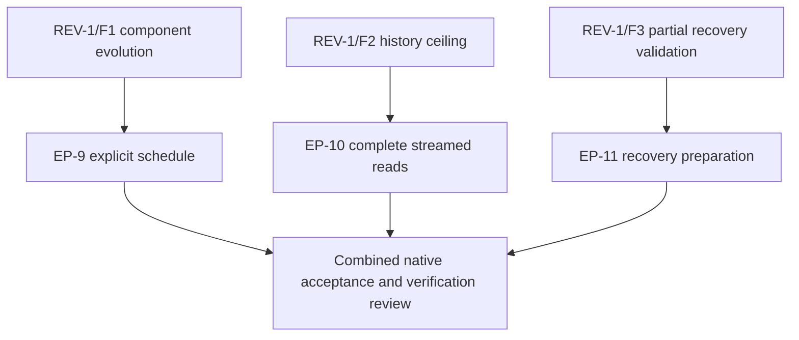

# Resolve initial library correctness architecture and API review findings

This MasterPlan is a living coordination document. Child plans own implementation
milestones; this registry owns their status. Update durable decisions in `docs/adr`
when their implementing change is accepted.

## Vision & Scope

Resolve all three findings in [REV-1](../reviews/initial-library-review.md).
Applications must be able to append a migration from an earlier library without
rewriting applied history; complete history must remain readable beyond 16 MiB;
and oversized recovery evidence must be rejected before any ledger append.
Preserve exact SQL bytes and checksums, the recorded global execution prefix,
explicit administrative coordination, complete-response evidence, and refusal to
automatically replay uncertain work.

This initiative covers core behavior, the public API, affected embedding/CLI
consumers, focused native tests and user contracts. Release packaging, publishing,
new server/platform qualification, production database changes and the external
consumer cutover gate in MasterPlan 1 are excluded. Implementation does not close that separate gate. The user-created intention is
recorded in frontmatter and inherited by all children.

## Decomposition Strategy

Three independently testable behaviors justify three children. EP-9 changes how
an application chooses execution order; EP-10 changes how history is transported;
EP-11 changes validation before recovery writes. Combining them would hide distinct
regression risks. A fourth general cleanup or release plan would add no necessary
behavior. They have no whole-child hard dependencies: each can be implemented and
accepted against the current library. Default execution is EP-9, EP-10, EP-11,
followed by the combined acceptance gate below. This sequence also keeps shared
module changes straightforward in a single checkout.

[ADR 0001](../adr/0001-preserve-uncertainty-across-runtime-boundaries.md) establishes
uncertainty across SQL and history writes. [ADR 0003](../adr/0003-bind-checksums-through-invariant-safe-definitions.md)
requires private definitions and context-bound checksums.
[ADR 0006](../adr/0006-freeze-immutable-ledger-and-explicit-coordination.md) requires
immutable contiguous events, a global prefix, strict duplicate/conflict handling,
coordination and full history reads. [ADR 0007](../adr/0007-scope-commands-and-preserve-acknowledged-progress.md)
requires scoped commands and acknowledged progress. [ADR 0008](../adr/0008-adopt-reviewed-prefixes-with-explicit-evidence.md)
requires complete adoption validation and mapping onto a native execution prefix.
These decisions remain constraints. EP-9 explicitly revises the coupling
between component grouping and execution order; EP-10 removes a total-response
ceiling without weakening completeness; EP-11 extends prevalidation to recovery.
No cross-repository architectural decision is needed to define these repairs.

## Exec-Plan Registry

| # | Title | Path | Hard Deps | Soft Deps | Status |
|---|-------|------|-----------|-----------|--------|
| 9 | Allow component upgrades with an explicit migration schedule | [ExecPlan 9](../plans/9-allow-component-upgrades-with-an-explicit-migration-schedule.md) | None | None | Complete |
| 10 | Stream complete ledger history with bounded row decoding | [ExecPlan 10](../plans/10-stream-complete-ledger-history-with-bounded-row-decoding.md) | None | None | Complete |
| 11 | Validate complete recovery events before mutation | [ExecPlan 11](../plans/11-validate-complete-recovery-events-before-mutation.md) | None | None | Complete |

Each child owns one finding, respectively REV-1/F1, REV-1/F2 and REV-1/F3. The
historical review stays unchanged when fixes land; child progress and the final
verification review record their resolution.

## Dependency Graph

The children have no blocking whole-child prerequisites. Their integration dependencies are shared
history definitions, request evidence and failure reports, rather than missing
prerequisite behavior. If implementation order changes, keep those contracts
consistent and rerun the combined gate. Do not convert the default execution
sequence into invented whole-child dependencies.

## Integration Points

**Definition order and history — EP-9 owns; EP-10 and EP-11 consume.** EP-9 adds an
explicit full schedule while retaining the component catalog and existing event
encoding. `Internal.LedgerCodec.definitions`, `Internal.Execution.orderedMigrations`,
reporting, adoption and the CLI must use the same ordered view. EP-10 must transport
all original events without reordering or rewriting them. EP-11 must prepare its
recovery events against the fresh projection and actual selected definition.

**Complete reads — EP-10 owns; all commands consume.** The new private JSON-row
stream mode retains the existing `Rows [Object]` outcome after complete validation.
It removes the aggregate wire-byte limit only for ledger history, bounds each row,
and returns no usable prefix on truncation, malformed data or a late server error.
The projection still retains history, so this initiative does not claim constant
heap use. Existing metadata/command response limits and deadlines stay enforced.

**Prepared writes and errors — EP-11 owns; reporting and CLI consume.** Recovery
size errors are distinguishable from corrupt stored events. `Internal.Execution`
may gain a private prepared-event append helper; it must preserve one submission,
exact receipts and acknowledgement updates. EP-9 uses it through existing runtime
boundaries rather than inventing a separate writer. EP-11 owns new error rendering;
EP-9 owns schedule rendering. Both update `docs/user/contracts/json-v1.md` and its
fixtures additively where possible.

**Early native evidence — each child owns its smallest consumer.** EP-9 first
applies A.one and B.one, then appends A.two through the public schedule API. EP-10
first reads the original 12-step large-audit fixture with default limits. EP-11
first rejects the reproduced oversized acceptance request with the ledger position
unchanged. Expand each test matrix only after its producer/consumer path passes.

**Combined gate — MasterPlan owns, final implementer executes.** On one disposable
server, apply two components, append an earlier-component migration using the
explicit schedule, and grow valid history above 16 MiB using bounded valid events.
Verify status/history/currentness with default limits. Interrupt a later step,
reject oversized accept evidence without advancing its position, accept valid
replacement evidence, finalize or resume explicitly as required, and verify
currentness. Inject a truncated history stream and prove no successor mutation.
Run existing runner, repair, adoption, ledger and CLI regression groups relevant to
these shared paths; no publication or release matrix is required. Capture concise
results in the plans and create a new `docs/reviews` record with the actual fixed
commit, linking REV-1 and these plans. Never mark these findings resolved from
compilation alone.

## Progress

All three children are Complete and the combined native gate passed. Full package
builds, all three unit suites, public invariant/checksum/adoption vectors,
embedding rebuild/source-free qualification, the mounted example, and all focused
native transport, ledger, runner, repair, adoption, failure-boundary, surviving-work
and CLI groups pass. Mid-body deadline/cancellation checks also pass. The post-fix
verification record is the only remaining coordination step. No external consumer
cutover is implied.

## Surprises & Discoveries

2026-10-16: Existing unit, public-invariant, runner and repair tests passed while
all three review reproductions failed as described. In particular, recovery had
already appended authorization before detecting an oversized acceptance event.
Existing small-history coverage is not sufficient evidence for the streaming work.

## Decision Log

2026-10-16: Use an application-owned append-only schedule rather than infer a new
order from database state or abandon global prefix validation. This preserves
replay determinism and the existing event/checksum format. Component dependency
names establish first activation order; the explicit schedule owns later upgrade
ordering, which EP-9 must document and test.

2026-10-16: Use one complete streamed ledger SELECT rather than multi-request
pagination. One response avoids introducing an inconsistent unguarded snapshot or
skipping conflicting duplicates at a page boundary. Wire buffers and rows remain
bounded; retained validated history remains proportional to history size.

2026-10-16: Keep recovery event size validation before its first append and reuse
prepared metadata rather than truncate audit evidence. A smaller valid request may
be supplied after a typed rejection; no automatic repair or evidence loss is added.

## Outcomes & Retrospective

Implementation outcomes will be recorded after acceptance. Before closing the
initiative, distill the scheduling, complete-read and recovery-validation decisions
into local ADRs, preserve the historical review, and record the combined gate and
verification review. MasterPlan 1's external consumer gate remains independent.
